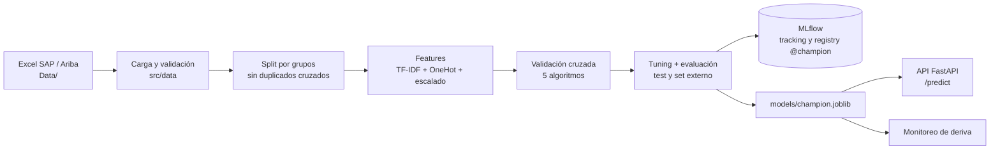
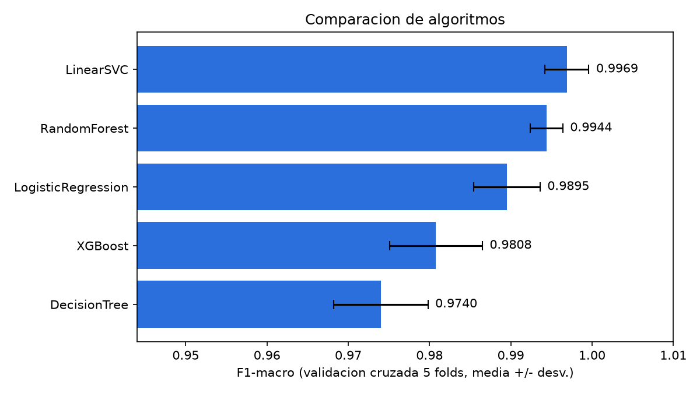
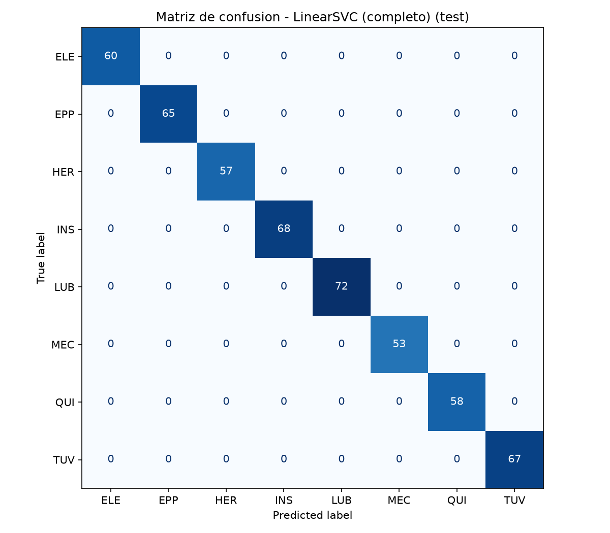
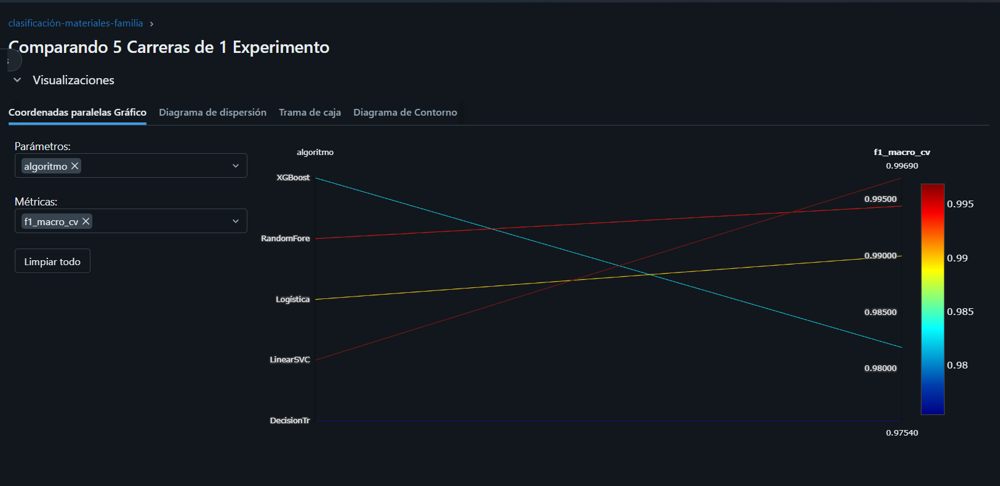
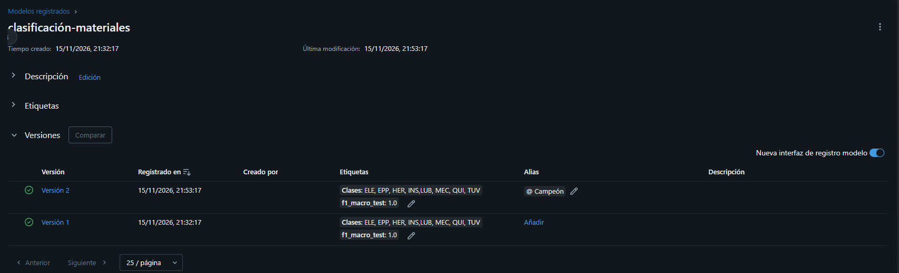
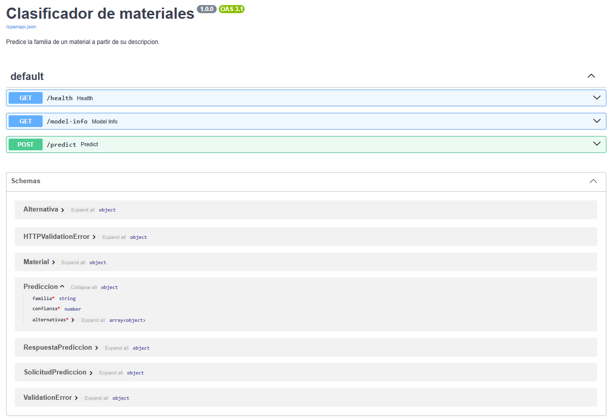

# Clasificación automática de materiales industriales

Proyecto final de la Especialización en Ciencia de Datos e Inteligencia Artificial, Universidad de Medellín.

## 1. Descripción ejecutiva

Modelo de Machine Learning que asigna automáticamente la **familia** de un material industrial (8 clases) a partir de su descripción en SAP, su marca, unidad de medida y datos de compra. El proyecto incluye el ciclo completo de MLOps: validación de datos, entrenamiento reproducible con validación cruzada, seguimiento de experimentos y registro de modelos en **MLflow**, una **API REST** para clasificar materiales nuevos, **Docker**, pruebas automáticas, monitoreo de deriva y un análisis de seguridad y privacidad.

**Resultado principal:** el modelo campeón (LinearSVC) obtiene **F1-macro 1.000** en el conjunto de prueba y **0.992** en 249 ítems de Ariba redactados en texto libre, frente a **0.72** de la clasificación SAP actual.

## 2. Planteamiento del problema

En el maestro de materiales de SAP, el campo *grupo de artículos* determina cómo se agrupan las compras, se analiza el gasto y se buscan proveedores. En los datos del proyecto, **solo el 54 % de los materiales tiene una clasificación correcta**:

| Estado de la etiqueta SAP actual | Materiales | % |
|---|---|---|
| Correcta | 1.351 | 54 % |
| Incorrecta | 399 | 16 % |
| Genérica (grupos comodín) | 397 | 16 % |
| Sin clasificar | 353 | 14 % |

Clasificar a mano miles de materiales es lento y poco consistente. Una clasificación errónea distorsiona el análisis de gasto, impide agrupar compras similares y dificulta encontrar proveedores especializados.

## 3. Objetivos

**General:** construir un clasificador reproducible y desplegable que asigne la familia correcta a cada material a partir de su información en SAP.

**Específicos:**
1. Preparar y validar los datos, evitando fugas de información entre entrenamiento y prueba.
2. Comparar varios algoritmos con validación cruzada y optimizar el mejor.
3. Superar a la clasificación SAP actual y a líneas base simples.
4. Registrar experimentos y versionar modelos con MLflow.
5. Exponer el modelo mediante una API segura y empaquetar la solución en Docker.
6. Documentar riesgos de privacidad y seguridad, limitaciones y monitoreo.

## 4. Alcance de la solución

- **Incluye:** clasificación por familia (8 clases) como objetivo principal; experimento adicional por categoría (40 clases); API de inferencia; pipeline reproducible; monitoreo de deriva.
- **No incluye:** subcategoría (120 clases), integración directa con SAP o Ariba, ni uso con datos reales de la organización (los datos son simulados).

## 5. Arquitectura



```
├── configs/config.yaml          # Rutas, split, CV, tuning, MLflow
├── Data/                        # Excel de entrada (datos ficticios)
├── src/
│   ├── data/                    # load_data.py (carga, grupo_id), validate.py
│   ├── features/                # build_features.py (preprocesador)
│   ├── models/                  # train.py, predict.py, tracking.py (MLflow)
│   ├── evaluation/              # evaluate.py, metrics.py, baselines.py, privacy_checks.py
│   ├── pipelines/               # run_pipeline.py (pipeline completo)
│   └── api/                     # main.py (FastAPI)
├── Monitoring/                  # drift_monitoring.py
├── tests/                       # 24 pruebas automáticas (pytest)
├── reports/                     # Métricas, gráficas y evidencias generadas
├── docs/                        # Seguridad y gobernanza, capturas
├── notebooks/                   # Análisis exploratorio (EDA)
├── Dockerfile, docker-compose.yml, requirements.txt
```

## 6. Datos

Archivo `Data/Maestro_verdad_simulacion.xlsx`, hoja `Maestro_materiales`: **2.500 materiales**, **datos ficticios generados con semilla 42**.

| Tipo | Variables |
|---|---|
| Objetivo | `Familia (código)`: ELE, EPP, HER, INS, LUB, MEC, QUI, TUV |
| Texto | Texto breve, Texto largo |
| Categóricas | Marca, UM |
| Numéricas | Precio base (USD), Filas ME2M, Ítems en eventos Ariba |
| Excluida | Grupo de artículos SAP actual (etiqueta ruidosa) |

Las 8 familias están balanceadas (entre 261 y 359 materiales). **100 materiales son duplicados declarados** de otros, lo que exige un split por grupos. La hoja `Verdad_items_texto_libre` (249 ítems de Ariba sin material SAP) se usa como prueba externa.

## 7. Metodología

1. **Validación de datos** (`validate.py`): columnas obligatorias, nulos en el objetivo y número de clases.
2. **Split sin fuga:** 80 % desarrollo y 20 % test con `StratifiedGroupKFold`; un material y su duplicado quedan siempre en el mismo conjunto. El test se usa una sola vez, al final.
3. **Features:** TF-IDF sobre texto breve + largo normalizado, OneHot de marca y UM, escalado de numéricas, todo dentro de un `Pipeline` de scikit-learn.
4. **Selección de algoritmo:** validación cruzada de 5 folds por grupos con LogisticRegression, LinearSVC, DecisionTree, RandomForest y XGBoost, usando F1-macro (clases balanceadas e igual importancia por familia).
5. **Selección de features:** conjunto completo frente a solo texto breve.
6. **Optimización:** `RandomizedSearchCV`; el modelo optimizado solo se acepta si supera al de por defecto.
7. **Evaluación final:** test reservado, prueba externa de texto libre y líneas base.

## 8. Tecnologías

| Tecnología | Uso |
|---|---|
| Python 3.11, pandas, scikit-learn, XGBoost | Datos y modelos |
| MLflow 3.18 | Seguimiento de experimentos, registro de modelos, alias `@champion` |
| FastAPI + Uvicorn | API REST con documentación automática |
| Docker + Docker Compose | Entorno reproducible: MLflow, entrenamiento y API |
| pytest | 24 pruebas automáticas |
| skops | Serialización segura del modelo en MLflow |
| Git + GitHub | Control de versiones |

## 9. Resultados y métricas

**Comparación de algoritmos** (validación cruzada de 5 folds por grupos, 2.000 materiales):

| Algoritmo | F1-macro CV |
|---|---|
| **LinearSVC** | **0.9969 ± 0.003** |
| RandomForest | 0.9944 ± 0.002 |
| LogisticRegression | 0.9895 ± 0.004 |
| XGBoost | 0.9808 ± 0.006 |
| DecisionTree | 0.9740 ± 0.006 |

- **Features:** el conjunto completo (0.9969) supera a solo texto breve (0.9957).
- **Optimización:** F1-macro CV de 0.9969 a **0.9979** (C=3, unigramas). Brecha entre entrenamiento y CV: 0.002, sin sobreajuste.

**Evaluación final del campeón (LinearSVC):**

| Conjunto | Accuracy | F1-macro | ROC-AUC | PR-AUC |
|---|---|---|---|---|
| Test reservado (500) | 1.000 | 1.000 | 1.000 | 1.000 |
| Externo: texto libre de Ariba (249) | 0.992 | 0.992 | 1.000 | 1.000 |

**Líneas base en el mismo test:**

| Enfoque | F1-macro |
|---|---|
| Azar (clase más frecuente) | 0.032 |
| Clasificación SAP actual (`grupo_sap`) | 0.722 |
| Sin texto (precio, marca, UM) | 0.743 |
| Solo texto breve (TF-IDF + LogReg) | 0.998 |
| **Modelo del proyecto** | **1.000** |

**Escalabilidad:** el mismo pipeline, sin cambios, alcanza **F1-macro 0.999** al predecir la **categoría (40 clases)**.

**Prevención de fuga:** al agrupar los duplicados en el split, el F1 de validación de RandomForest bajó de 1.000 a 0.988, lo que confirmó que la fuga existía y quedó corregida.

| Comparación de algoritmos | Matriz de confusión (test) |
|---|---|
|  |  |

## 10. Seguimiento con MLflow

Cada ejecución del pipeline registra en MLflow:
- **Run principal:** parámetros (algoritmo, features, hiperparámetros, versiones de Python y librerías), 17 métricas, artefactos (config, reportes, gráficas) y commit de git.
- **Runs hijos:** uno por algoritmo evaluado en validación cruzada, para compararlos.
- **Modelo:** con firma (*signature*), ejemplo de entrada y dependencias fijadas. Se registra como `clasificacion-materiales` con alias **`@champion`**.

Cargar el modelo campeón desde el registro:
```python
import mlflow
mlflow.set_tracking_uri("sqlite:///mlflow.db")
modelo = mlflow.pyfunc.load_model("models:/clasificacion-materiales@champion")
```

| Comparación de runs | Registro de modelos |
|---|---|
|  |  |

## 11. Seguridad y privacidad

Detalle completo en [`docs/seguridad_y_gobernanza.md`](docs/seguridad_y_gobernanza.md). Resumen de lo **implementado y verificado** (`python -m src.evaluation.privacy_checks`):

- **Minimización:** el modelo usa solo 7 columnas del maestro de materiales; no usa compradores, proveedores ni pedidos. Los compradores vienen seudonimizados.
- **Sin datos personales** en las entradas ni dentro del modelo guardado (0 correos, teléfonos o números tipo cédula).
- **Membership inference:** un ataque de caja negra obtiene **AUC 0.506**, equivalente al azar.
- **API:** API key opcional, límite de 100 materiales por solicitud, validación de entradas y logs sin el texto de los materiales.
- **Docker:** usuario sin privilegios, datos fuera de la imagen (solo lectura), dependencias fijadas, puertos solo en `127.0.0.1`.
- **Modelo seguro de cargar:** MLflow lo guarda con skops, que no ejecuta código al cargar.

Este proyecto **no afirma cumplimiento** de la Ley 1581 de 2012 ni del GDPR; el documento lista las validaciones pendientes para usarlo con datos reales.

## 12. Instalación

Requisitos: Python 3.11, Git y, para la opción con contenedores, Docker Desktop.

```powershell
git clone https://github.com/marianarada/proyecto_final_clasificacion_materiales.git
cd proyecto_final_clasificacion_materiales
python -m venv .venv
.venv\Scripts\activate            # Mac/Linux: source .venv/bin/activate
pip install -r requirements-dev.txt
```

Los datos ya vienen en `Data/`; no hay que copiar nada.

## 13. Ejecución local

Ejecutar siempre desde la raíz del proyecto, con `python -m`:

```powershell
python -m pytest                                        # 24 pruebas
python -m src.pipelines.run_pipeline                    # entrena, evalúa y registra en MLflow (~2 min)
python -m src.pipelines.run_pipeline --target categoria # experimento adicional (40 clases)
python -m src.evaluation.privacy_checks                 # verificaciones de privacidad
python -m Monitoring.drift_monitoring                   # monitoreo de deriva
python -m src.models.predict --texto "GUANTE DE NITRILO TALLA L" --um par
```

Interfaces:
```powershell
mlflow ui --backend-store-uri sqlite:///mlflow.db --port 5000   # http://127.0.0.1:5000
uvicorn src.api.main:app --port 8000                            # http://127.0.0.1:8000/docs
```

## 14. Ejecución con Docker

```powershell
docker compose build                    # construye la imagen (~3 min la primera vez)
docker compose up -d mlflow             # MLflow en http://127.0.0.1:5000
docker compose run --rm train           # entrena dentro del contenedor y registra en MLflow
docker compose up -d api                # API en http://127.0.0.1:8000/docs
docker compose down                     # detiene todo (modelo y experimentos se conservan)
```

Activar la API key (PowerShell):
```powershell
$env:API_KEY = "una-clave-segura"
docker compose up -d api
```

Ejemplo de predicción:
```powershell
$body = '{"materiales":[{"texto_breve":"GUANTE DE NITRILO TALLA L","um":"par"}]}'
Invoke-RestMethod -Method Post -Uri http://127.0.0.1:8000/predict -ContentType "application/json" -Body $body -Headers @{"X-API-Key"="una-clave-segura"}
```

Respuesta: familia `EPP` con confianza 0.99 y dos alternativas. El campeón LinearSVC da el mismo resultado en Windows y dentro del contenedor Linux.



## 15. Limitaciones

- **Datos simulados y muy separables:** la primera palabra del texto breve basta para acertar cerca del 95 % de los casos. Con descripciones reales de SAP (abreviaturas, errores, textos ambiguos) se espera un desempeño menor.
- La prueba externa no trae marca, UM ni precio; se usan valores neutros.
- El modelo siempre asigna una de las 8 familias conocidas; no detecta familias nuevas. El monitoreo de deriva alerta cuando llegan materiales de otro dominio.
- RandomForest varía ligeramente entre versiones de librerías; LinearSVC es determinista.

## 16. Escalabilidad y trabajo futuro

- Validar con descripciones reales de SAP y Ariba.
- Predecir **subcategoría** (120 clases) con un enfoque jerárquico: familia → categoría → subcategoría.
- Enviar a revisión humana las predicciones de baja confianza y reentrenar con esas correcciones.
- Programar el monitoreo de deriva sobre cada lote real y automatizar el reentrenamiento.
- Integrar la API con SAP o Ariba para sugerir el grupo de artículos al crear el material.
- Despliegue en la nube con autenticación, HTTPS y límite de solicitudes.

## 17. Equipo

Proyecto desarrollado por el equipo del curso, Universidad de Medellín.